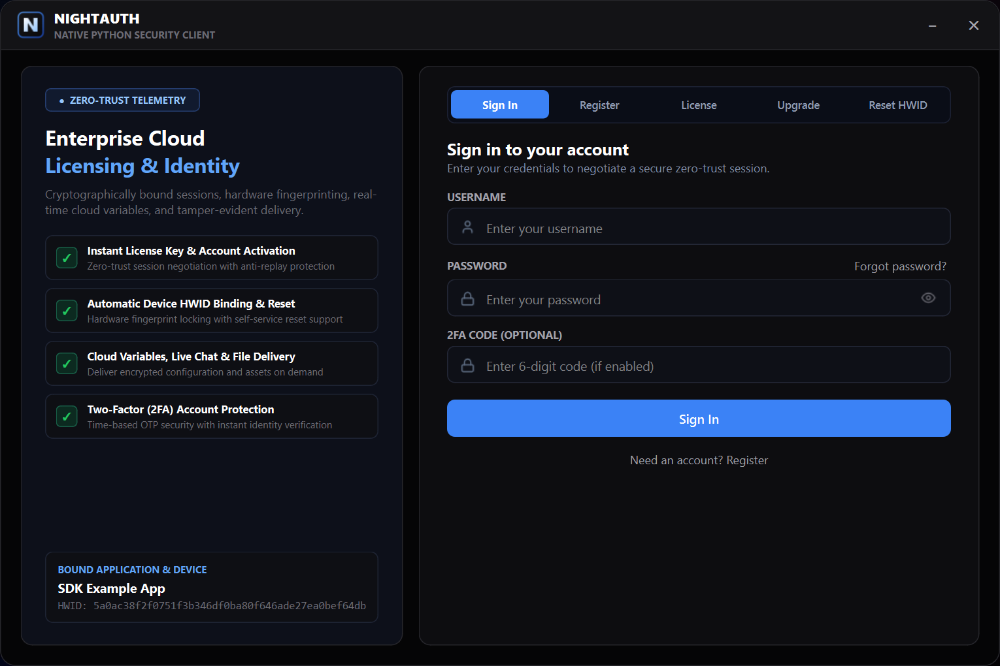
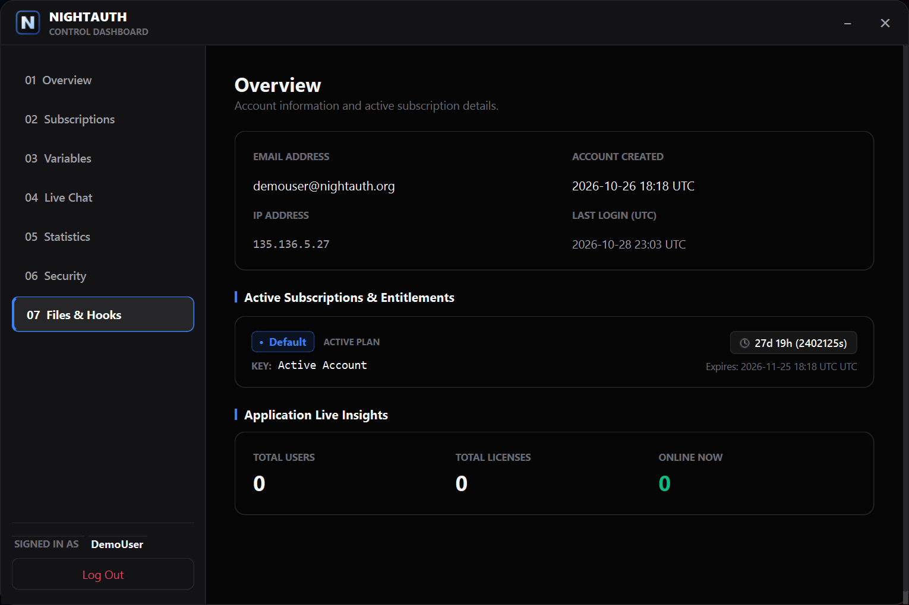
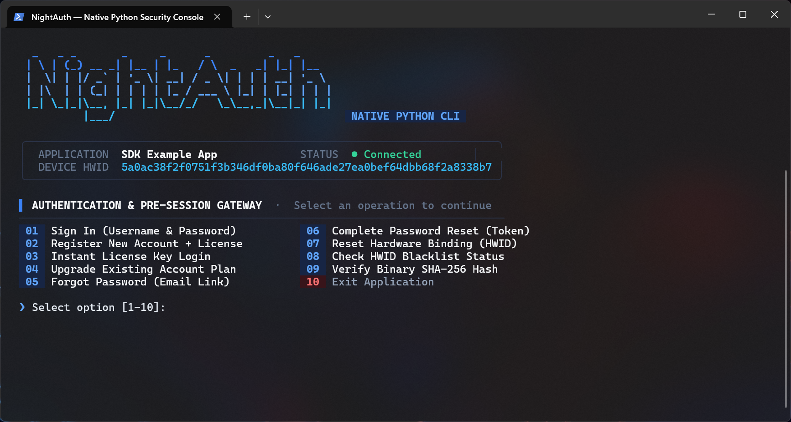
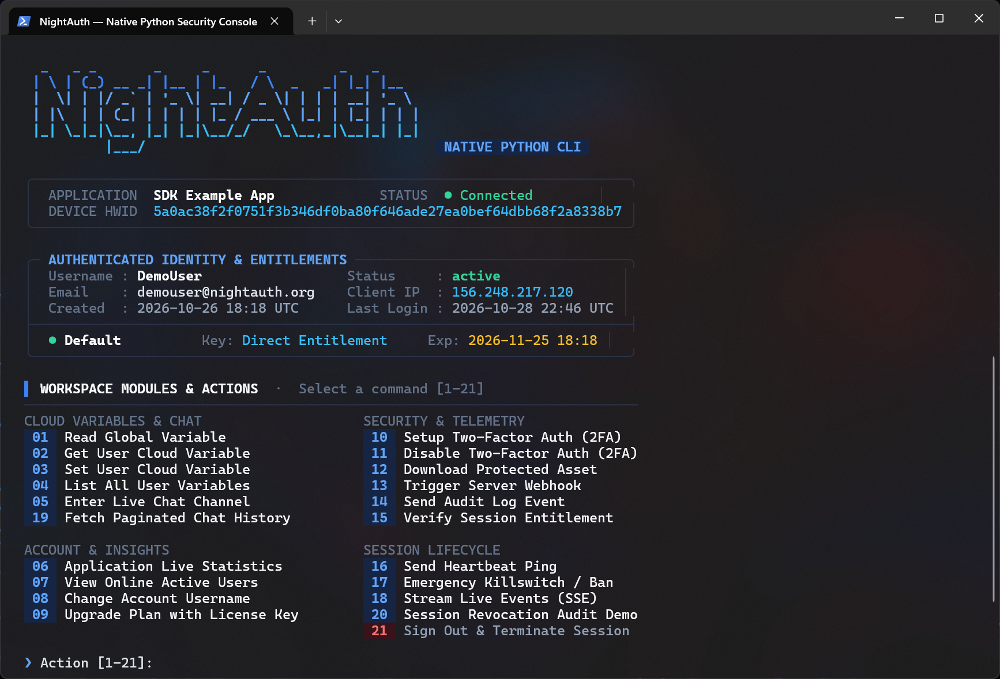

# NightAuth Python SDK — Ajoutez une étoile sur GitHub ⭐

SDK officiel **NightAuth** pour Python et suite cliente de référence complète (Interface de bureau moderne en **PyQt6** et CLI interactive en **Rich**). Protégez vos logiciels contre le piratage, l'ingénierie inverse et la falsification grâce aux licences cloud, au verrouillage HWID, au chat en temps réel et à l'exécution en mémoire en quelques minutes.

**Languages / Idiomas / Langues / Sprachen:**  
[English](../README.md) • [Español](es.md) • [Français](fr.md) • [Deutsch](de.md) • [Italiano](it.md) • [Português](pt.md) • [Русский](ru.md) • [Türkçe](tr.md) • [Polski](pl.md) • [中文](zh.md)

---

> [!NOTE]
> ### 📺 Tutoriels Vidéo et Guides de Configuration
> Les tutoriels vidéo officiels et les guides pas à pas détaillant la configuration des applications, abonnements, variables cloud, webhooks et licences dans le tableau de bord NightAuth **seront publiés prochainement** sur notre portail et chaîne officielle.

---

## 📸 Captures d'Écran

### Application Bureau (Desktop UI — PyQt6)

| Écran de Connexion / Authentification | Tableau de Bord & Abonnements |
| :---: | :---: |
|  |  |

### Application Console (CLI — Rich)

| Connexion en Terminal | Tableau de Bord Interactif Console |
| :---: | :---: |
|  |  |

---

## 🛡️ Bonnes Pratiques de Sécurité Recommandées

* **Compilation Native et Obfuscation :** Le bytecode Python est facilement décompilé. Pour vos versions de production, compilez vos scripts en code machine natif C/C++ (.pyd ou .exe) via **Nuitka** ou **PyArmor**.
* **Virtualisation de Code Entreprise :** Protégez l'exécutable final avec des virtualiseurs de code professionnels tels que **VMProtect**, **Themida** ou **Enigma Protector**.
* **Intégrité Mémoire & Anti-Debug :** NightAuth intègre une protection contre les intercepteurs réseau et débogueurs (HTTPDebugger, CheatEngine, x64dbg, Wireshark). Conservez ces protections actives en production.
* **Exécution Sécurisée en Mémoire :** Lors du téléchargement de fichiers protégés avec `api.download()`, **n'écrivez pas les octets sur le disque dur**. Exécutez-les directement en mémoire (avec `io.BytesIO` ou RunPE) et nettoyez immédiatement les tampons.

---

## 📦 Prérequis et Installation

```bash
pip install -r requirements.txt
```

---

## ⚙️ Configuration et Initialisation

```python
from nightauth import api

APP_NAME = ""
APP_API_KEY = ""
APP_VERSION = "1.0"
APP_TOKEN = None

NightAuthApp = api(
    name=APP_NAME,
    apikey=APP_API_KEY,
    version=APP_VERSION,
    token=APP_TOKEN
)
```

### init()

Vous devez appeler `init()` avant toute autre opération pour établir l'échange de clés Diffie-Hellman (X25519) et la session chiffrée :

```python
NightAuthApp.init()

if not NightAuthApp.response.success:
    print(f"Error: {NightAuthApp.response.message}")
    exit(1)
```

---

## 🚀 Guide d'Utilisation du SDK

### 1. Validation de Session & Liste Noire (Blacklist)

```python
NightAuthApp.check()
if NightAuthApp.checkblack():
    exit(0)
```

### 2. Connexion avec Nom d'utilisateur & Mot de passe (et 2FA)

```python
if NightAuthApp.login(username, password, two_factor_code=""):
    print(f"Welcome {NightAuthApp.user.username}")
```

### 3. Inscription avec Clé de Licence

```python
if NightAuthApp.register(username, password, license_key, email=""):
    print("Registered successfully")
```

### 4. Authentification par Clé de Licence Uniquement

```python
if NightAuthApp.license(license_key):
    print("License authenticated")
```

### 5. Mise à Niveau du Compte / Activer une Nouvelle Clé

```python
if NightAuthApp.upgrade(username, new_license_key):
    print("Subscription upgraded")
```

### 6. Réinitialisation du Verrouillage HWID

```python
if NightAuthApp.reset_hwid(username, password, two_factor_code=""):
    print("HWID reset completed")
```

### 7. Récupération de Compte / Mot de Passe Oublié

```python
if NightAuthApp.forgot_password(email):
    print("Recovery token sent")
```

### 8. Données Utilisateur (`NightAuthApp.user`)

```python
print(NightAuthApp.user.username, NightAuthApp.user.ip, NightAuthApp.user.hwid)
for sub in NightAuthApp.user.subscriptions:
    print(sub.subscription, sub.expiry)
```

### 9. Variables Cloud Globales

```python
val = NightAuthApp.var("server_motd")
```

### 10. Variables Personnalisées par Utilisateur

```python
NightAuthApp.set_user_var("discord", "user#0001")
val = NightAuthApp.get_user_var("discord")
```

### 11. Journaux d'Audit Applicatifs

```python
NightAuthApp.log("Security telemetry or detection")
```

### 12. Bannissement d'Utilisateurs & Blocage Machine

```python
NightAuthApp.ban("Tampering detected")
```

### 13. Webhooks Sécurisés Côté Serveur

```python
resp = NightAuthApp.webhook("7kR0UedlVI", params="&action=notify", body='{"content": "Notice"}')
```

### 14. Téléchargement Sécurisé de Fichiers en Mémoire

```python
file_bytes = NightAuthApp.download("385624")
```

### 15. Salons de Discussion en Temps Réel

```python
NightAuthApp.chat_send("Hello!", channel="general")
msgs = NightAuthApp.chat_get(channel="general")
```

### 16. Gestionnaires d'Événements en Temps Réel (SSE)

```python
NightAuthApp.on_session_invalidated = lambda r: print(f"Session invalidated: {r}")
NightAuthApp.on_app_banned = lambda r: print(f"App banned: {r}")
NightAuthApp.on_app_status_changed = lambda s: print(f"Status changed: {s}")
NightAuthApp.on_version_updated = lambda v: print(f"Update: v{v}")
```

---

## 📄 Licence

Ce projet est sous licence **Elastic License 2.0**. Consultez le fichier [LICENSE](../LICENSE) pour les termes légaux complets.
